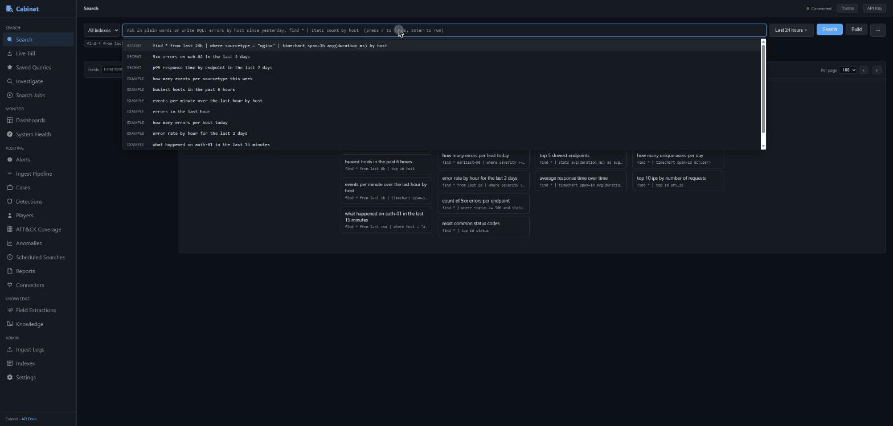
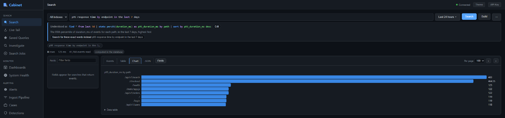
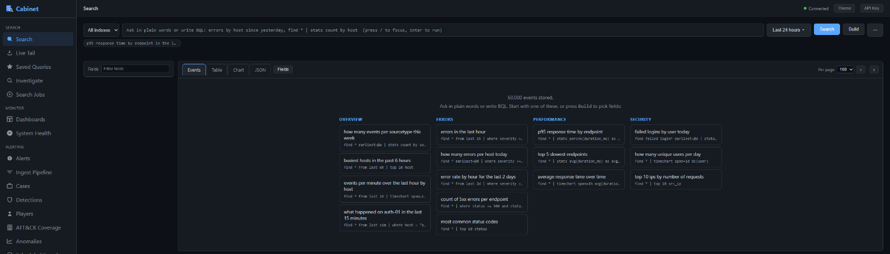
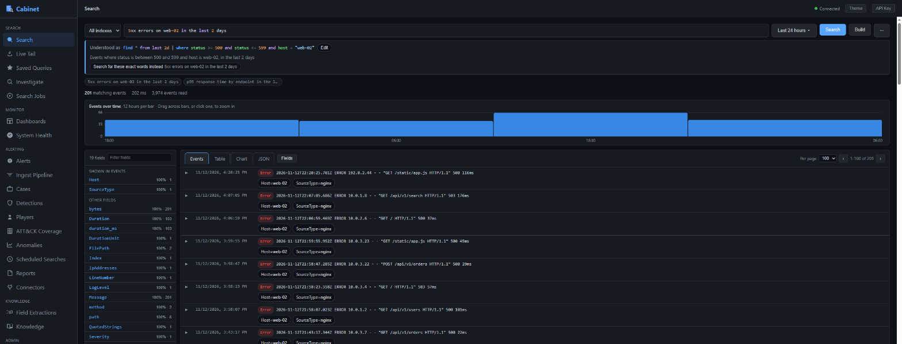
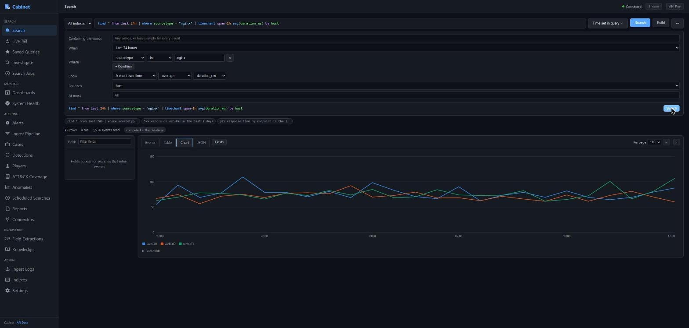
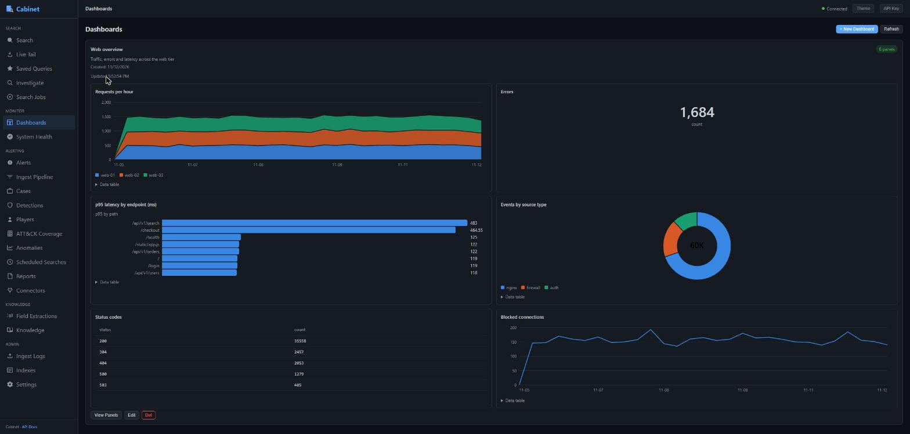
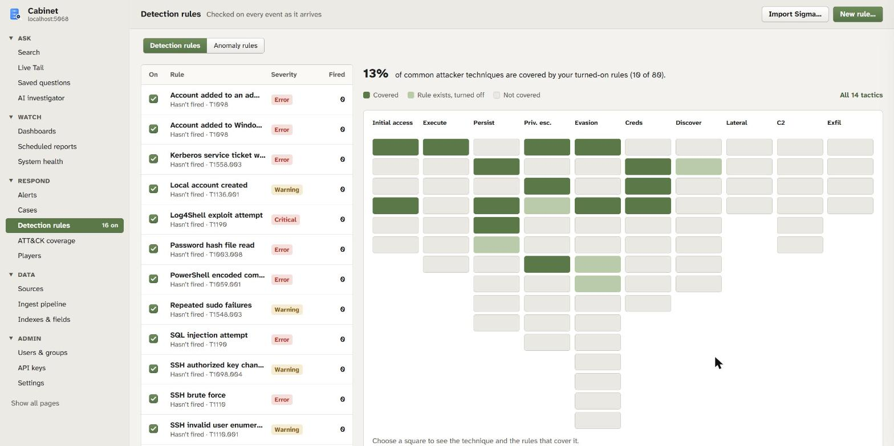

<p align="center">
  
</p>

<p align="center">
  <strong>Ask your logs anything.</strong><br>
  Self-hosted log search and security analytics. Plain-English questions, SPL when you want it,<br>
  its own fast storage engine, and nothing to license.
</p>

<p align="center">
  <a href="https://dotnet.microsoft.com/"></a>
  <a href="https://github.com/bogware/cabinet/actions/workflows/ci.yml"></a>
  <a href="LICENSE"></a>
  <a href="src/Cabinet.Agent/LICENSE"></a>
</p>

<p align="center">
  <a href="#quick-start">Quick start</a> ·
  <a href="docs/BQL-GUIDE.md">Query guide</a> ·
  <a href="docs/FEATURES.md">Features</a> ·
  <a href="docs/BENCHMARKS.md">Benchmarks</a> ·
  <a href="docs/DEPLOYMENT.md">Deployment</a>
</p>

<p align="center">
  
</p>

## Why Cabinet

<table>
<tr>
<td width="50%" valign="top">

### Ask in plain words
Type *"errors on web servers since yesterday by host"* or *"p95 response time by endpoint"*. Cabinet reads it into a query, shows you exactly what it understood, and fixes typos as it goes. Field names come from your own data. SPL works too, so people coming from Splunk keep their habits.

</td>
<td width="50%" valign="top">

### Fast on one machine
The built-in Cabinet engine stores a million events in 50 MB, counts them in under a millisecond, and computes a 95th percentile per host in about 0.2 s. It writes 120,000 events a second from a single writer, with every batch on disk before it's acknowledged.

</td>
</tr>
<tr>
<td valign="top">

### Lean to run
One server process with no database to run, no JVM, and no cluster to babysit. It runs on Linux, Windows, Docker or Kubernetes. PostgreSQL, OpenSearch and ClickHouse are there when you need several instances, an existing cluster, or more than one machine's disk.

</td>
<td valign="top">

### Secure and dependable
Per-index access control, masking, encryption at rest, SSO (OIDC, SAML, LDAP) and a hash-chained audit log. Delivery is at-least-once with server-side de-duplication, and chaos tests kill the agent, the API and the database mid-stream.

</td>
</tr>
</table>

## Ask in plain words

The search box, the CLI and the API all take questions in ordinary words, in any order. Each one runs as a real query, so you can always see and edit what ran.

| You type | Cabinet runs |
|---|---|
| `errors on web servers since yesterday by host` | `find * earliest=-1d@d \| where severity >= error and host like "web%" \| stats count by host \| sort by count desc` |
| `how many unique users per day` | `find * \| timechart span=1d dc(user)` |
| `top 5 slowest endpoints` | `find * \| stats avg(duration_ms) as avg_duration_ms by path \| sort by avg_duration_ms desc \| head 5` |
| `POST requests over 1000 ms` | `find * \| where duration_ms > 1000 and method = "POST"` |
| `count of 5xx errors per endpoint` | `find * \| where status >= 500 and status <= 599 \| stats count by path \| sort by count desc` |
| `erors by hots` | `find * \| where severity >= error \| stats count by host \| sort by count desc` |

When a question is ambiguous, Cabinet doesn't guess. It offers the likely readings, marks the part it didn't follow, and can hand the question to the optional AI assistant, which runs on a local model by default. Saved searches, alerts and detection rules always store the exact query, so their meaning can't drift. The [query guide](docs/BQL-GUIDE.md#ask-in-plain-words-natural-language) covers what it understands.

<p align="center">
  
</p>

## Quick start

### Docker Compose

```bash
git clone https://github.com/bogware/cabinet.git && cd cabinet
cp .env.example .env          # set each value; openssl rand -hex 32 makes a good one
docker compose up -d
```

Open `http://localhost:5000` and sign in with the `CABINET_API_KEY` from `.env`.

### From source

```bash
dotnet run --project src/Cabinet.API     # .NET 10 SDK; development mode on http://localhost:5068
```

To use the Cabinet engine, set `Storage__Type=Cabinet`; SQLite is the default. Packages, installers, systemd units and the Windows service are in [docs/DEPLOYMENT.md](docs/DEPLOYMENT.md).

### Send some logs

```bash
# Splunk HEC: point existing Splunk senders at Cabinet
curl http://localhost:5000/services/collector/event -H "Authorization: Splunk $CABINET_API_KEY" \
  -d '{"event": "Failed password for alice from 203.0.113.7", "sourcetype": "auth", "host": "auth-01"}'

# Or ask from the command line
cabinet query "failed logins by user today" --server http://localhost:5000
```

Cabinet also takes OpenTelemetry (OTLP/HTTP), syslog, a REST API, and its own forwarding agent for files, the systemd journal, Windows event logs and Kubernetes.

## A look around

<table>
<tr>
<td width="50%"><br><sub>Starter questions fitted to your own hosts and fields.</sub></td>
<td width="50%"><br><sub>Events with a timeline, field summaries and one-click filters.</sub></td>
</tr>
<tr>
<td><br><sub>Build a search by picking fields, or type one.</sub></td>
<td><br><sub>Dashboards with nine chart types and auto-refresh.</sub></td>
</tr>
<tr>
<td colspan="2"><br><sub>Detections mapped to MITRE ATT&CK, with Sigma rules imported in one paste.</sub></td>
</tr>
</table>

## What's inside

- **Search**: plain-English questions, BQL, and SPL syntax (OR, NOT, phrases, wildcards, `earliest=`), `stats` and `timechart`, `top` and `rare`, `eval`, `rex`, `transaction`, `join`, lookups, macros, subsearches, `cluster` for log patterns, `iplocation`, and async search jobs.
- **Storage**: the Cabinet engine (write-ahead log, compressed column segments, per-block summaries and Bloom filters, background merges), plus SQLite, PostgreSQL, OpenSearch and ClickHouse. Retention per index, and archive to a folder or S3 before deletion.
- **Ingest**: Splunk HEC, OpenTelemetry logs, traces and metrics, syslog, REST, and an agent with a disk spool and checkpoints, so outages and restarts don't lose or repeat lines. An ingest pipeline drops, samples, routes or redacts before anything is stored.
- **Detection and response**: rules evaluated on every event at ingest, 29 built-in rules, Sigma import, ATT&CK coverage, anomaly rules (spikes, silence, new values, new kinds of line), backtesting, cases, and actions to Slack, Teams, PagerDuty, Opsgenie, Jira, ServiceNow, email and webhooks.
- **Dashboards and reports**: line, area, bar, pie, single value, gauge, heatmap, map and table panels, and scheduled reports emailed as HTML with a PDF.
- **Access and audit**: API keys with tiers and expiry, OIDC, SAML and LDAP sign-in, roles and per-index grants on every endpoint, field masking, AES-256-GCM encryption at rest, and a hash-chained audit log.
- **Operations**: health and Prometheus metrics, OpenTelemetry tracing of its own work, several instances on PostgreSQL, Kubernetes manifests, and verified backups.

The [feature list](docs/FEATURES.md) says how finished each part is.

## Performance

One million events of web traffic on an 8-core desktop, queried through the full engine. The [benchmarks](docs/BENCHMARKS.md) give the setup and the other backends.

| Query | Cabinet engine | SQLite | PostgreSQL |
|---|---:|---:|---:|
| Count everything | 0.1 ms | 144 ms | 44 ms |
| Count by host | 107 ms | 4.6 s | 292 ms |
| Hourly timechart | 34 ms | 3.0 s | 720 ms |
| Average and p95 by host | 201 ms | 14 s | 3.8 s |
| Top 10 paths | 144 ms | 13 s | 15 s |
| Size on disk | 50 MB | 838 MB | |

## Coming from Splunk

- Existing senders work: Cabinet speaks the HTTP Event Collector protocol, including `Authorization: Splunk <token>`.
- SPL searches run: `search error | stats count by host | sort -count | head 10` means what it does in Splunk, and the [guide](docs/BQL-GUIDE.md#spl-compatibility) lists the differences.
- Sigma rules import directly, and detection rules live as YAML with tests (`cabinet rules test`, `push`, `pull`).
- There's no per-gigabyte license. You run it on your own hardware, and your data stays there.

## Known limitations

Cabinet is honest about what it doesn't do yet. The main gaps today:

- **One machine is the sweet spot.** Several instances need PostgreSQL. The Cabinet engine serves one instance and isn't clustered.
- **Plain-English reading is English only.** Unusual phrasings come back as choices rather than a guess.
- **Some backups aren't drill-tested yet.** SQLite and PostgreSQL backups are tested in CI; Cabinet engine and OpenSearch snapshots aren't yet.
- **`/metrics` is unauthenticated**, and API keys aren't compared in constant time. Restrict the metrics endpoint at the network ([SECURITY.md](SECURITY.md)).

The full list is in [docs/FEATURES.md](docs/FEATURES.md#known-limitations).

## Documentation

| | |
|---|---|
| [Query guide](docs/BQL-GUIDE.md) | Plain-English questions, BQL, every command and function, SPL compatibility |
| [Deployment](docs/DEPLOYMENT.md) | Installing, configuring, storage backends, backups, scaling, the agent |
| [API guide](docs/API-GUIDE.md) | The REST API; `api-spec.json` is the OpenAPI spec |
| [Features](docs/FEATURES.md) | What works today, and the known limitations |
| [Benchmarks](docs/BENCHMARKS.md) | Measured ingest and query speed on each backend |
| [Architecture](docs/ARCHITECTURE.md) | Layers, design decisions, the engine and query internals |
| [Contributing](CONTRIBUTING.md) · [Security](SECURITY.md) · [Changelog](CHANGELOG.md) | |

## License

Cabinet is licensed under the [GNU AGPL v3.0](LICENSE), except the forwarding agent (`src/Cabinet.Agent`), which is under the [Apache License 2.0](src/Cabinet.Agent/LICENSE) so it can run anywhere without conditions.

Running Cabinet for your own organization carries no obligations. If you modify the server and offer it to others over a network, the AGPL asks you to offer them your modified source. Releases before 3.0 remain under Apache-2.0.
